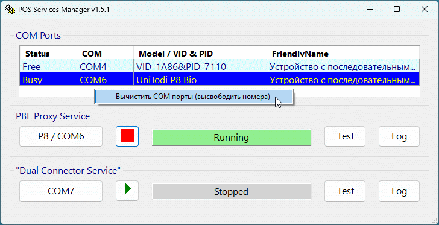

## POS Services Manager
Приложение для тестирования POS терминалов

### Возможности:
* Работа без установки (как мобильное приложение) на 32 и 64-битной версии Windows. Скачайте и запустите [⬇️ ServMan.exe](https://raw.githubusercontent.com/mozers3/POS-Services-Manager/main/ServMan.exe)
* Приложение автоматически запрашивает права Администратора (требуется работа в привилегированном режиме)
* Отображает все, эмулируемые через USB, подключенные COM порты.
* Определяет популярные модели подключенных устройств
* Позволяет делать очистку списка COM портов от предыдущих подключений, что позволяет освободить занятые фантомами номера COM.
* Показывает состояние системных служб и позволяет ими управлять
* Показывает текущие настройки файлов конфигураций сервисов и позволяет их мгновенно изменить.
* Добавлены кнопки для запуска связанных тестовых программ и показа лога сервиса за текущий день.

### Подсказки:
* При остановленном сервисе у выбранного порта должен быть статус Free. Если это не так - ищите программу, которая заняла этот порт (TermAssist например).
* Если после запуска сервиса выбранный COM порт изменяет свой статус на Busy - значит связь успешно установлена. Можно проводить тесты.
* Учтите, что последние версии сервисов могут игнорировать COM порт, прописанный в конфигурации. Обратите внимание (по статусу Busy) на какой порт реально прицепился сервис и, если он не совпадает с заданным в конфиге, измените его для надежности.
